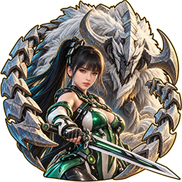
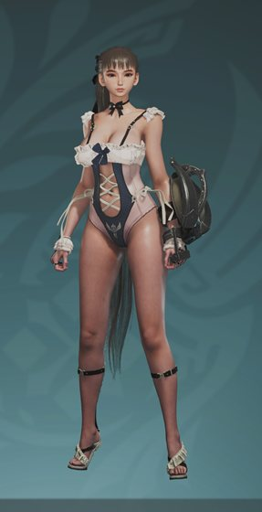
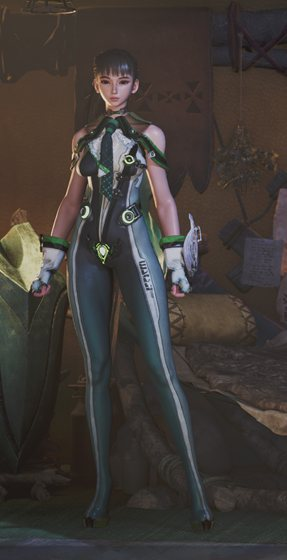
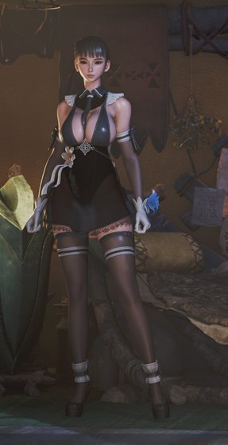
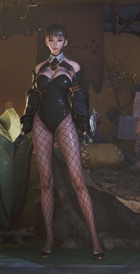
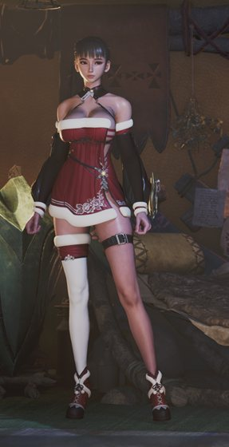
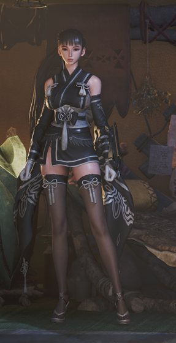

  

<h1 align="center">Stellar Eve for Monster Hunter Wilds</h1>

  Play Monster Hunter Wilds offline as Eve from Stellar Blade, in 22 of her outfits. 
  Built on your PC from your own games: no game files are included. 
  <b>English</b> · <a href="README.ko.md">한국어</a>

       

> **Quick start:** **Code > Download ZIP** → extract → close the game → double-click **`install.bat`** →
> choose a language → tick outfits → **Install**. Remove later with **Stellar Eve > Uninstall** (see [Uninstall](#uninstall)).

## How it works
1. The installer downloads the conversion tools (Blender, RE Mesh Editor, ...) from their official sources.
2. It takes Eve's body, face, hair and outfit from your Stellar Blade, and the armor files to replace from your Monster Hunter Wilds.
3. Blender moves Eve onto the hunter skeleton (pose, weights, physics) and saves her in the Wilds formats (mesh, mdf2, tex, chain2).
4. The new files go in place of that armor (any original that gets replaced is backed up first).
5. In game, a REFramework script acts only while an Eve outfit is worn: Eve's face, Eve's proportions (joint positions),
   and the other armor pieces that would overlap are hidden (helms stay). Any other armor gives you the normal hunter back.
6. Step 3 then applies the approved look (common skin colour, neck seam, outfit fixes checked in game) from `data/repro`:
   only numbers (vertex offsets / normals / weights, material node recipes, a few setting changes), no game or Stellar Blade
   data. The recipes are baked into the textures from your own Stellar Blade files (`scripts/eve_repro*.py`).

## Requirements
- **Stellar Blade** and **Monster Hunter Wilds** on Steam (any drive)
- **REFramework**: put `dinput8.dll` from `REFramework.zip` ([REFramework-nightly releases](https://github.com/praydog/REFramework-nightly/releases))
  next to `MonsterHunterWilds.exe`.
- About 25 GB free space and internet (the needed tools are downloaded automatically)

## Install
1. On this page press **Code > Download ZIP** (always the latest version, every outfit inside, about 2 MB) and extract it to a
   folder without spaces or non-English characters (e.g. `D:\stellar-eve`).
2. Close Monster Hunter Wilds and **double-click `install.bat`**.
   `install.bat` compiles the source in this folder (`tools\launcher\StellarEve.cs`) into `StellarEve.exe` with the .NET compiler
   that comes with Windows, then starts it. No ready-made executable is downloaded, so you can read the source yourself.
   - If Windows shows **"The publisher could not be verified"**, press **Run**. Windows marks files from a downloaded ZIP, and an
     unsigned batch file always gets this question. The first run clears the mark in this folder, so it does not come back.
     To avoid it from the start: before extracting, right-click the ZIP → **Properties** → tick **Unblock** → OK.
3. **Choose the language (한국어 / English).** Every screen, outfit name and armor name follows it (switch any time with `한국어 / Language` on the home screen).
   **Before you install** on the home screen checks Monster Hunter Wilds, REFramework, Stellar Blade, free space and the folder path.
   - Red ✖: install is blocked. If a game was not found, pick its folder with **Choose folder** (non-Steam locations work too).
   - Orange !: install works but needs attention. Without REFramework, **Download page** opens where to get it.
4. Press **Install / add outfits**: a window with a picture of each outfit opens. Each card shows Eve's outfit name (official Stellar Blade name),
   the armor to wear in Wilds, where to find it in the appearance menu, and the DLC it needs. **Tick the outfits you want** and press **Install**
   (clicking a picture ticks it too; **Select all** for every outfit).
   - `Build at once`: how many outfits to build at the same time (3 on a strong PC). `Desktop + Start menu shortcut`: makes `Stellar Eve` shortcuts.
5. The progress window shows the **percentage and the current step**. When it says `Done! Start the game.` you are finished.
   In game, wear the **armor from the table below as layered appearance** to see that outfit (the armor has to be crafted in game to show up in the appearance list).

- Want only one outfit? Download the same ZIP (the outfit data is numbers only, so it is small) and pick just that number.
- The latest release under [Releases](https://github.com/RXTIGA90/stellar-eve-wilds-builder/releases) has the same files as **Source code (zip)**. The newest is always **Code > Download ZIP**.
- **Adding an outfit later**: run the `Stellar Eve` shortcut (or `install.bat`) again and tick only the new outfits. Outfits installed before stay installed.
- Without windows (text mode): `install.bat -Rows 158,147` (ids from the table), `install.bat -All`, numbered list: `install.bat -NoGui`.
  Only then is a PowerShell window (`install.ps1`) shown. In window mode the same `install.ps1` does the work; its output is the
  progress window's log and is saved to `install_log.txt`.
- Faster on a strong PC: `install.bat -Jobs 3` builds 3 outfits at the same time (about 4 CPU threads and 6 GB RAM each).
- DLC outfits are built only from a Stellar Blade with that DLC installed. Without it that outfit is skipped and the rest is installed.
  If one outfit fails, the others are still installed and `failed outfits` tells you which one.
- Blender and the other tools need no separate install: the installer puts them in this folder's `tools\` (nothing is installed
  on the PC; deleting the folder removes them).

**How long it takes** (measured 2026-10-21 on a clean install, 16-thread PC, NVIDIA GPU, `-Jobs 3`; slower without a GPU):
| Step | Time |
|---|---|
| Tool downloads (Blender, .NET, editors, about 1 GB) | 2.5 min here (depends on the connection), first run only |
| Taking Eve's files out of both games | 1.5 min, first run only |
| Eve's face + both default looks | 4 min |
| All 20 outfits | 19 min with `-Jobs 3` (one at a time: about 45 min) |
| **Total** | **27 min** |

**Outfits** (bold = name in the English game, second line = Korean game; when the same armor has two rows, Eve's outfit is the ◆ row)

| id | Eve outfit (Stellar Blade name) | Armor to wear in Wilds (English / Korean game) | Where in the appearance menu | DLC | Code |
|---|---|---|---|---|---|
| 27 | **Ocean Maid** 오션 메이드 | **Outfit type 4 (β ◆)** 옷 타입 4 (옷β ◆) | Change Appearance → Hunter → outfit type | - | `CH_P_EVE_27` |
| 63 | **Wave Diver Bikini** 웨이브 다이버 비키니 | **Outfit type 3 (β ●)** 옷 타입 3 (옷β ●) | Change Appearance → Hunter → outfit type | - | `CH_P_EVE_63` |
| 144 | **Planet Diving Suit (7th)** 플래닛 다이브 슈트(7th) | **Dahaad γ** 다하딜라γ | Appearance menu → Hunter layered armor → Chest | - | `CH_P_EVE_09` |
| 146 | **War Dress** 워 드레스 | **Sakuratide α** 앵파α (the ◆ row in the list) | Appearance menu → Hunter layered armor → Chest | - | `CH_P_EVE_59_TypeB` |
| 147 | **Elegant Dress** 엘레강스 드레스 | **Blossom α** 블로섬α (the ◆ row in the list) | Appearance menu → Hunter layered armor → Chest | NIKKE | `CH_P_EVE_Nikke_02` |
| 148 | **Planet Diving Suit (6th)** 플래닛 다이브 슈트(6th) | **Afi α** 아피α (the ◆ row in the list) | Appearance menu → Hunter layered armor → Chest | - | `CH_P_EVE_08` |
| 149 | **Blue Monsoon** 블루 몬순 | **Diver α** 다이버α (wear it on Chest and Waist, the ◆ row in the list) | Appearance menu → Hunter layered armor → Chest | - | `CH_P_EVE_43` |
| 150 | **YoRHa Unofficial Ceremonial Attire** 요르하 비공식 의례복 | **Dreamwalker α** 고스투라α | Appearance menu → Hunter layered armor → Chest | NieR | `CH_P_EVE_Nier_03` |
| 151 | **Motivation** 모티베이션 | **Harvest α** 하베스트α | Appearance menu → Hunter layered armor → Chest | - | `CH_P_EVE_25` |
| 152 | **Cyber Bunny** 사이버 버니 | **Ceremonial α** 세레모니얼α (the ◆ row in the list) | Appearance menu → Hunter layered armor → Chest | - | `CH_P_EVE_47` |
| 153 | **Santa Dress** 산타 드레스 | **Orion α** 오리온α | Appearance menu → Hunter layered armor → Chest | - | `CH_P_EVE_Christmas_01` |
| 156 | **Orca Engineer** 오르카 엔지니어 | **Bale Armor α** 역경 아머α | Appearance menu → Hunter layered armor → Chest | - | `CH_P_EVE_15_V02` |
| 157 | **FourSeconds Destroyed Denim** 포세컨즈 디스트로이드 데님 (no approved-look data: plain automatic build, not checked in game) | **Omega Attire α** 오메가 의상α (not checked in game (plain automatic build)) | Appearance menu → Hunter layered armor → Chest | - | `CH_P_EVE_51` |
| 158 | **YoRHa Uniform 1** 요르하 제복 1 | **Azure Age α** 푸른빛무사α | Appearance menu → Hunter layered armor → Chest | NieR | `CH_P_EVE_Nier_02` |
| 159 | **Daily Force** 데일리 포스 | **Sororal α** 퀸α | Appearance menu → Hunter layered armor → Chest | - | `CH_P_EVE_39` |
| 185 | **Red Passion** 레드 패션 | **Guild Knight** 길드나이트 | Appearance menu → Hunter layered armor → Chest | - | `CH_P_EVE_26` |
| 190 | **FourSeconds Everyday Wear** 포세컨즈 에브리데이 웨어 | **Noblesse** 노블레스 | Appearance menu → Hunter layered armor → Chest | - | `CH_P_EVE_50_TypeB` |
| 192 | **Cooling Suit** 냉각 슈트 | **Cypurrpunk** 브레이크캣 (the ◆ row in the list) | Appearance menu → Hunter layered armor → Chest | NIKKE | `CH_P_EVE_Nikke_06` |
| 195 | **Missing Link** 미싱 링크 | **Cosmoloid** 코스모로이드 | Appearance menu → Hunter layered armor → Chest | NIKKE | `CH_P_EVE_Nikke_05` |
| 9041 | **Racer's High** 레이서즈 하이 | **Mizutsune β** 미츠네β (the ◆ row in the list) | Appearance menu → Hunter layered armor → Chest | - | `CH_P_EVE_41` |
| 9018 | **Daily Mascot** 데일리 마스코트 | **Rey Dau γ** 레다젤트γ (the ◆ row in the list) | Appearance menu → Hunter layered armor → Chest | - | `CH_P_EVE_18` |
| 9034 | **Moutan Peony** 모란 | **Nu Udra γ** 이그졸스γ | Appearance menu → Hunter layered armor → Chest | - | `CH_P_EVE_34_body` |

## Uninstall
**Always uninstall before deleting the folder** (deleting it first also deletes the backup of the originals).
1. Close Monster Hunter Wilds.
2. Start menu `Stellar Eve > Stellar Eve uninstall`, or start `Stellar Eve` and press **Uninstall (restore the game)**, or double-click `uninstall.bat` in the folder.
3. Press **Yes**. When it says `Uninstalled. The game is back as it was.` you can delete this folder.

What uninstall does:
- **Deletes every file this installer added** to the Monster Hunter Wilds folder (listed in `work\game-backup\added.txt`) and
  **puts back every original it replaced** from the backup (`work\game-backup\`). Folders it created and that are now empty are removed.
- Removes the `Stellar Eve` desktop and Start menu shortcuts that point to this folder.
- **Save data, REFramework (`dinput8.dll`) and other mods are not touched.**
- There is no "remove one outfit": uninstall everything, then install only the outfits you want.
- Something wrong after a game update: uninstall → Steam "Verify integrity of game files" → install again.

## Troubleshooting
| Message | What to do |
|---|---|
| `... is not in your Stellar Blade (DLC not installed?): skipped` | that DLC is not installed, so only that outfit was skipped. Install the DLC, run `install.bat` again and pick that number |
| `Stellar Blade not found` / `Monster Hunter Wilds not found` | give the folders: `install.bat -SbPaks "...\StellarBlade\SB\Content\Paks" -MhwDir "...\MonsterHunterWilds"` |
| `REFramework is not installed` | install REFramework (see Requirements) |
| `Monster Hunter Wilds is running` | close the game and run again |
| `build failed` | send the logs in `work\logs\` |

Offline use only. Never share the built files (`work\`) or the installed files.

## Security and privacy
- **Nothing is sent anywhere.** The internet is used only to download the tools listed in `deps.json` from their official sources; every download is checked with SHA-256/512 and the installer stops on a mismatch. (Building the .NET tools also lets dotnet fetch version-pinned packages from nuget.org.)
- **No ready-made executables.** `StellarEve.exe` and the two .NET tools (`tools\sb-extract`, `tools\motion-convert`) are built on your PC from the source in this folder.
- What it changes: this folder, the Monster Hunter Wilds folder (added files are listed in `work\game-backup\added.txt`, replaced originals are backed up), and the desktop / Start menu shortcuts (when ticked). The registry is only **read** to find Steam; startup programs, scheduled tasks, firewall and antivirus settings are never touched.
- The in-game script (`stellar_eve_outfit_bones.lua`) only reads and writes JSON files in REFramework's `reframework\data\stellar-eve\`.
- Note: CUE4Parse (reads the Stellar Blade files) pins SixLabors.ImageSharp 3.1.12, so the build shows a known-vulnerability warning for it. It only reads the Stellar Blade textures on your own PC, never images from the internet.

## License
Code: MIT ([LICENSE](LICENSE)). Third-party tools: [THIRD_PARTY_NOTICES.md](THIRD_PARTY_NOTICES.md).
Stellar Blade and Monster Hunter Wilds and all their assets belong to their owners (SHIFT UP / Sony Interactive
Entertainment and CAPCOM); this project is unofficial and not affiliated with them.
